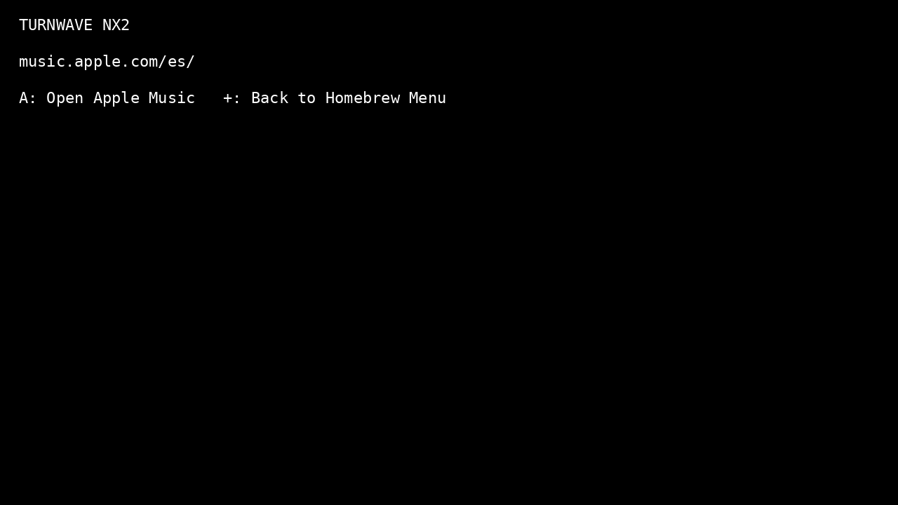

# Turnwave NX2

Turnwave NX2 is an independent homebrew launcher for Nintendo Switch 2. It opens the official Apple Music website in the system web applet. Sign-in, browsing and playback are provided by Apple Music. The launcher requires internet access and works without a separate server or developer credentials.



The image is a desktop reconstruction of the launcher screen. Web applet availability, controller navigation inside the website, sign-in and playback still need verification on Switch 2 hardware. Full-track playback requires an active Apple Music subscription and a compatible browser.

## Install

1. Copy `TurnwaveNX2.nro` to `switch/TurnwaveNX2/TurnwaveNX2.nro` on the SD card.
2. Launch **Turnwave NX2** from Homebrew Menu.
3. Press **A** to open [Apple Music](https://music.apple.com/es/) or **+** to return to Homebrew Menu.

The launcher opens the Spanish storefront. If the system web applet returns an error, the launcher displays its hexadecimal result code.

## Build

Install [devkitPro](https://devkitpro.org/) with the Switch toolchain and [ounce-devkit](https://github.com/ouncebrew/ounce-devkit) with libounce. Set `DEVKITPRO` and `DEVKITA64` for your installation and add the development tools to your PATH.

```sh
make
```

The output is `TurnwaveNX2.nro`. Built with libounce 20261117.1.

## Trademarks

Apple Music is a service mark of Apple Inc. Nintendo Switch is a trademark of Nintendo. Turnwave NX2 is an independent project and has no affiliation with Apple or Nintendo.
