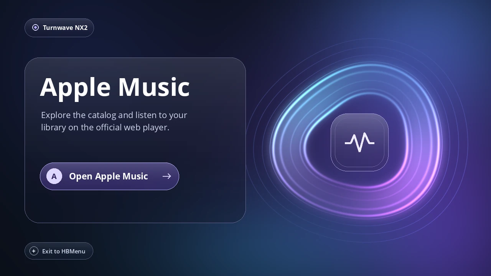

> **Native Engine 0.7 (experimental):** A browser-free Switch 2 prototype is available in [standalone/](standalone/README.md). Local PCM playback and Apple catalog metadata are separate from the legacy Chromium-based application below. Full protected Apple Music playback remains unsupported and hardware validation is pending.

# Turnwave NX2

## v0.5.0 experimental — native UI + Chromium MusicKit playback probe

**Status: source prototype only. Not built or tested on Nintendo Switch 2 hardware. No DRM bypass or confirmed audio playback.**

The main Turnwave interface is native, while a separately built Chromium NX2 instance handles Apple Music sign-in, library sync, and an experimental `MusicKit.setQueue()` / `play()` probe. The architecture is informed by [AMTV](https://github.com/megarohas/apple-music-android-tv), which runs the official Apple Music web player, but Turnwave does not execute Android or bundle the AMTV APK.

See the complete **[v0.5.0 setup, controls and diagnostics](README_ES.md)** (Spanish).

### Obtain/update source in WSL

```bash
git clone https://github.com/amariscalc/turnwave-nx2.git
cd turnwave-nx2
./tests/syntax-check.sh
python3 chromium-bridge/install.py ~/switch2-dev/chromium-nx-diagnostico --check
python3 chromium-bridge/install.py ~/switch2-dev/chromium-nx-diagnostico
```

After rebuilding Chromium with your existing Docker toolchain, build Turnwave native with `./build-native.sh` (requires your ounce-devkit container plus Pillow/NumPy/Open Sans fonts).

Update future changes with `git pull` instead of handling source ZIPs.

The old v1.3.3 applet prototype is retained in the original top-level `source/`, `design/`, and `Makefile`; the **new application lives in `native/`**.

---

## Previous version: v1.3.3 OpenWeb applet

Turnwave NX2 is a homebrew application for Nintendo Switch 2 that opens the official Apple Music web player. It has a controller-friendly home screen and connects directly to Apple Music through the system web applet. Setup requires no extra server or Apple Developer credentials.



## Install and use

1. Copy `TurnwaveNX2.nro` to `switch/TurnwaveNX2/TurnwaveNX2.nro` on the SD card.
2. Open **Turnwave NX2** from Homebrew Menu.
3. Press **A** to open [Apple Music](https://music.apple.com/es/). Press **+** or **B** on the app’s home screen to exit.

The app opens the Spanish storefront. Apple Music handles sign-in, search, library access and playback in its web player. Full-track playback requires an active Apple Music subscription and a compatible browser. The screen above is rendered from the same assets as the NRO. The home screen has been verified on physical hardware. Version 1.3.3 uses the Switch 2 OpenWeb identifier and the SDK’s News navigation configuration, which includes the initial domain in the allowed navigation set. The 1.3.1 and 1.3.2 hardware tests returned web exit reason 10 after the system displayed “This function is not available.” The cause of that exit is still under investigation. Web loading, sign-in and playback require further validation on Switch 2.

On the home screen, press **X** to open the plain HTTPS page at `example.com` through the same browser configuration. This check helps determine whether the observed closure also occurs on a simple page. Press **A** for Apple Music. The app logs each attempt separately during the session.

If opening the web player fails, the home screen displays a hexadecimal result code. Details are written to `switch/TurnwaveNX2/diagnostics.log` on the SD card. The log contains SDK call results and the applet exit reason. It is replaced on each app launch.

## Build from source

Install [devkitPro](https://devkitpro.org/) with the Switch toolchain and [ounce-devkit](https://github.com/ouncebrew/ounce-devkit) with libounce. Set `DEVKITPRO` and `DEVKITA64` and add the SDK tools to your PATH. The interface renderer also needs Python 3 with NumPy, Pillow and the Open Sans font family. Set `TURNWAVE_FONTS` to the directory containing the Open Sans TTF files if they are installed outside the default Linux path.

```sh
make
```

The output file is `TurnwaveNX2.nro`. Version 1.3.3 was built with libounce 20261117.1.

## Trademarks

Apple Music is a service mark of Apple Inc. Nintendo Switch is a trademark of Nintendo. Turnwave NX2 is an independent project with no affiliation with Apple or Nintendo.
