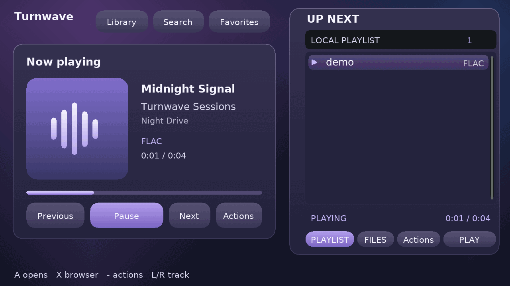
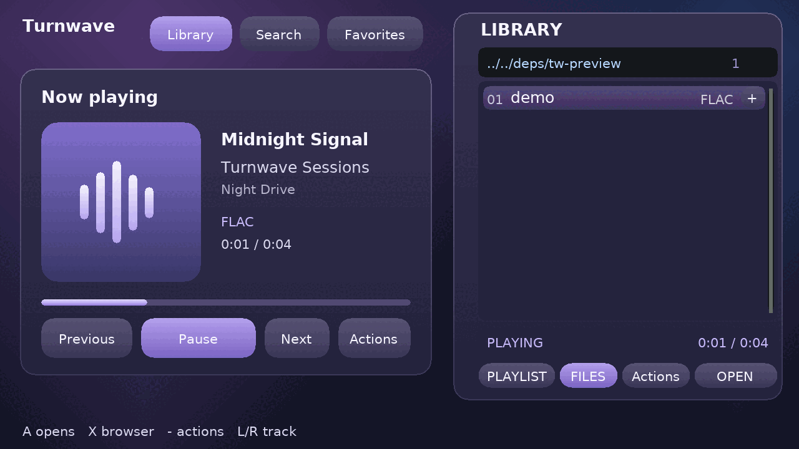

# Turnwave NX2

Turnwave is a native offline music player for Nintendo Switch 2. It plays audio files stored on the SD card and builds a searchable library on the console.

## Screenshots

Turnwave Local v1.0 running at 1280 × 720 in the desktop build.

## Install

[Download the latest release](https://github.com/amariscalc/turnwave-nx2/releases/latest).

Copy `switch/Turnwave/Turnwave.nro` to the SD card, put your music in `/music`, and launch **Turnwave** from hbmenu.

Turnwave includes library search by artist, album and genre, favorites, an editable queue, M3U8 playlists, JPEG cover art, LRC lyrics, CUE chapters, ReplayGain and adjustable playback speed. Use the controller or touchscreen to navigate the interface.

## Build

With devkitPro and libounce installed and `DEVKITPRO` set, run `make -C local-player switch`. The executable is generated at `local-player/build/Turnwave.nro`.

See the [player documentation](local-player/README.md) for controls, detailed build instructions and desktop tests.
